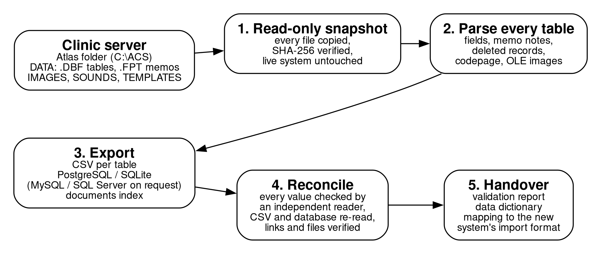

# xbase-export

Read-only, validated export of dBase / FoxPro / Visual FoxPro databases to CSV, SQLite and PostgreSQL.

Many locally installed practice-management and EHR systems keep their data as `.DBF` tables with `.FPT`/`.DBT` memo files and `.CDX` indexes, with no SQL server behind them. When a clinic changes software, the vendor's own reports usually export only part of that data. `xbase-export` reads the files directly. It exports every table, the clinical notes held in memo files, records the application has flagged deleted, embedded photos, and the scanned documents and images linked to each record. It then proves the export is complete by reconciling every value against an independent reader.

## What it does

| Step | Detail |
|---|---|
| Inventory | Every file in the source folder classified (table, memo, index, document, program, archive) with size, timestamp and SHA-256 |
| Snapshot | Source copied and verified by SHA-256 before parsing; the source is never opened for writing |
| Parse | Header-level parser for dBase III/IV, FoxPro 2.x and Visual FoxPro: all field types including memo, currency, datetime, integer, OLE/general, VFP null flags and varchar; codepage from the language-driver byte |
| Recover | Deleted-flagged records, memo text with original line breaks, binary objects to files, truncated tables (complete records recovered, missing ones counted) |
| Export | One UTF-8 CSV per table, deleted records separately, a SQLite database, PostgreSQL DDL and load script |
| Infer | Candidate keys and foreign-key relationships from the data; orphans split into "parent flagged deleted" and "no parent at all" |
| Documents | File paths in any column resolved against the snapshot (drive letters and UNC prefixes handled); missing and unreferenced files listed; folder-name attribution to patients |
| Validate | Order-independent fingerprints of every column compared between the toolkit reader, [dbfread](https://github.com/olemb/dbfread), the CSV files, SQLite and (optionally) PostgreSQL |
| Report | Validation report (Markdown and JSON), data dictionary (Excel and CSV), schema diagram (Graphviz), `data_issues.csv` with the raw stored text of every unreadable value |

## Demonstration

`examples/make_synthetic_clinic.py` writes a fictitious 20-year chiropractic practice in Visual FoxPro format: 9,025 patients, 120,960 appointments, 104,005 visits with SOAP notes, 207,829 diagnoses, 148,308 charges, 96,756 payments and 8,722 linked documents. Faults that real legacy databases contain are planted in it: deleted-flagged records, impossible dates, a truncated table, appointments for patients removed from the table, and missing image files. All names, notes and amounts are synthetic (Faker, fixed seed).

On that database a full run takes about 2 minutes on one CPU core (snapshot on local disk). It exports 706,506 records from 13 tables, and all 52 value-level reconciliations (13 tables, four comparisons each) are identical. It reports every planted fault with the exact count planted. See [`docs/`](docs/) for the generated validation report, schema diagram and a patient chart rebuilt from the export.



## Quick start

```bash
pip install .                       # Python 3.9+; installs dbfread and openpyxl
xbase-export inspect /path/to/TABLE.DBF
xbase-export run /path/to/APP_FOLDER /path/to/output \
    [--snapshot-dir /mnt/encrypted/snapshot] \
    [--psql "psql -h localhost -d archive"]   # optional: load into PostgreSQL and verify
```

To try it on synthetic data:

```bash
pip install faker pillow
python examples/make_synthetic_clinic.py /tmp/demo --patients 2000
xbase-export run /tmp/demo/ACS /tmp/demo_out --examples
```

The output folder must be outside the source folder. Example values are left out of the data dictionary unless `--examples` is given, because on real data they would be patient information.

## How validation works

Each value is reduced to a canonical text form: exact decimals, ISO dates, millisecond datetimes, `1`/`0` booleans and SHA-256 for binary content. Each column then gets a 64-bit hash sum over its values together with a count of non-empty values. Sums do not depend on row order, so the comparison works between systems that return rows in different orders. A single changed character in any output file changes the fingerprint of that column, and the test suite checks this (`tests/test_pipeline.py::test_tampered_csv_is_detected`).

When a table file ends in a partial record, dbfread parses the fragment as a row. The toolkit detects this and compares on complete records only, and the report says so.

## Tests

```bash
pip install -e ".[test]" faker pillow
pytest
```

The 21 tests cover known-answer header and value parsing, a hand-built dBase III table with a `.DBT` memo, truncated tables, invalid dates and numeric overflow, round trips of canonical values, and an end-to-end regression run on a small synthetic clinic.

## Limitations

- Visual FoxPro tables that belong to a database container (`.DBC`) store long field names in the container. Field names are currently taken from the table header (10 characters).
- Index files (`.CDX`, `.IDX`, `.NDX`, `.MDX`) are inventoried but not parsed; they hold no data that is not in the tables.
- Encrypted tables, and data held only in an application's program files, are out of scope.
- Relationship inference finds keys that the data supports; it cannot see rules that live only in application code. Inferred relationships should be confirmed against the application's screens.

## Licence

MIT
